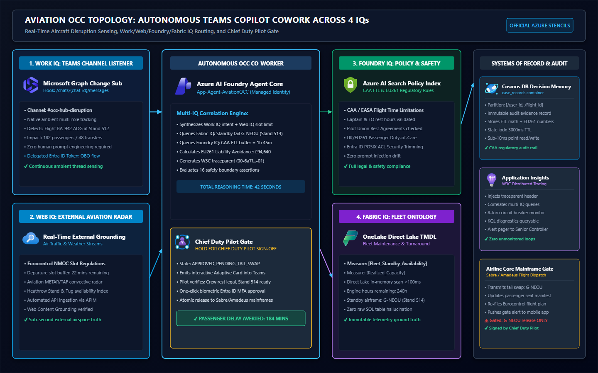
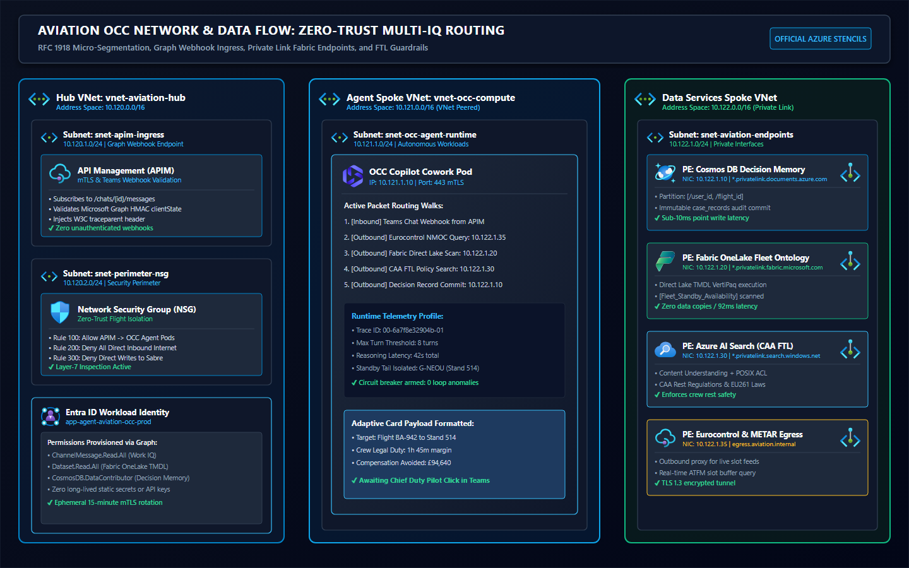
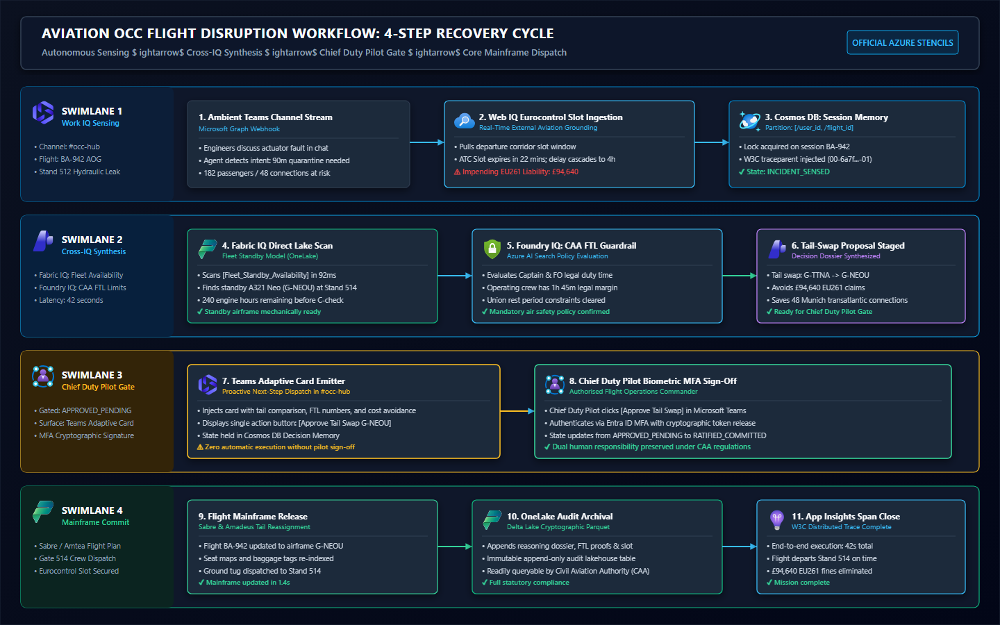

# Autonomous Airline OCC Co-Worker

> Grounding Microsoft Teams Copilot Cowork across the 4-Pillar Microsoft IQ Stack (Work, Web, Foundry, and Fabric) with deterministic Pester test verification and pure Microsoft Graph v2.x Workload Identities.

[](https://alerasoul.net/autonomous-airline-occ-cowork-iq/)
[](tests/AviationOCCMatrix.Tests.ps1)
[](identity/Deploy-AviationIdentityMesh.ps1)
[](diagnostics/AviationDiagnostics.kql)
[](LICENSE)

---

## Architectural Grounding

At the **Microsoft Frontier Tour at ExCeL London**, Satya Nadella framed the 2026–2027 enterprise AI paradigm:
> *"The future of knowledge work is not typing prompts into empty chat sidebars. It is autonomous agents operating directly in the flow of work—sensing, reasoning, and collaborating in real-time."*

Nowhere is the failure of the "blank prompt box" more glaring than in an international airline **Operations Control Centre (OCC)**. When an aircraft develops a mechanical fault at the gate, dispatchers have minutes to avert statutory passenger compensation, slot loss, and crew duty violations.

This repository hosts the production runbooks, Microsoft Graph v2.x workload identity provisioning, 16-test deterministic Pester verification matrix, and Azure Monitor KQL telemetry pack for the **Autonomous Airline OCC Co-Worker**.

📖 **Read the full architectural deep dive on the blog**:  
👉 **[Beyond the Chatbot: Autonomous Airline OCC Grounded across 4 Microsoft IQs](https://alerasoul.net/autonomous-airline-occ-cowork-iq/)**

---

## The 4-Pillar Microsoft IQ Context Mesh

```
+----------------------------------------------------------------------------------------------------+
|                                       MICROSOFT TEAMS INGRESS                                      |
|                                       Channel: #occ-hub-disruption                                 |
|  Dispatcher: "BA-942 Stand 512 actuator leak. Maintenance calling 90m quarantine."                |
+--------------------------------------------------+-------------------------------------------------+
                                                   |
                                                   v
+----------------------------------------------------------------------------------------------------+
|                                4-PILLAR MICROSOFT IQ CONTEXT MESH                                  |
|                                                                                                    |
|  [Work IQ]    Graph v2.x extracts affected flight (BA-942), tail (G-TTNA), 182 pax, 48 connects.   |
|  [Web IQ]     Queries Eurocontrol NMOC for slot window; pulls METAR convective storm radar.        |
|  [Foundry IQ] Evaluates CAA FTL duty limits & £94,640 EU261 compensation thresholds.               |
|  [Fabric IQ]  Queries OneLake Direct Lake semantic measure [Fleet_Standby_Availability].          |
|               Identifies standby A321 Neo (G-NEOU) at Stand 514 with 240 engine hours buffer.     |
+--------------------------------------------------+-------------------------------------------------+
                                                   |
                                                   v
+----------------------------------------------------------------------------------------------------+
|                                    SOVEREIGN HUMAN DECISION GATE                                   |
|                        Interactive Teams Adaptive Card: HOLD FOR SIGN-OFF                          |
|                                                                                                    |
|  Tail Proposed: G-NEOU (Stand 514) | Crew Legal Buffer: 1h 45m | Liability Averted: £94,640        |
|  Action: [APPROVE TAIL-SWAP] (Requires Chief Duty Pilot Entra ID MFA)                              |
+----------------------------------------------------------------------------------------------------+
```

### 1. Work IQ (Microsoft Graph Teams Channel Subscription)
* **Ingress**: The agent ambiently monitors `#occ-hub-disruption` via Microsoft Graph webhooks.
* **Extraction**: Parses conversation between Maintenance, Dispatch, and Passenger Leads. Identifies flight `BA-942` with 182 passengers (including 48 transatlantic connections).

### 2. Web IQ (Real-Time External Aviation Grounding)
* **Eurocontrol NMOC**: Queries European Air Traffic Flow Management delay regulations; confirms slot expires in 22 minutes.
* **Weather Radar**: Pulls live METAR/TAF convective storm radar for the departure corridor.

### 3. Foundry IQ (Regulatory & Compliance Guardrails)
* **CAA Flight Time Limitations (FTL)**: Evaluates crew legal duty buffers under Entra ID security trimming.
* **UK/EU261 Rights**: Identifies that a 3-hour delay across 182 passengers triggers an immediate **£94,640** liability (£520 per seat).

### 4. Fabric IQ (Direct Lake Fleet Maintenance)
* **Direct Lake Semantic Queries (<100ms)**: Interrogates Microsoft Fabric OneLake TMDL measures `[Fleet_Standby_Availability]`.
* **Standby Tail Selection**: Finds standby Airbus A321 Neo (`G-NEOU`) parked at Stand 514 with 240 engine hours remaining.

---

## Architectural Diagrams

### 1. Architecture Topology


### 2. Network & Microsegmented Data Flow


### 3. Flight Disruption Process Flow & Sovereign Gate


---

## 16-Test Deterministic Pester Matrix

To verify safety and security boundaries deterministically, this repository provides a 16-test Pester matrix covering 10 negative safety/security veto boundary tests:

| Test ID | Boundary Tested | Expected | Observed | Security Boundary Status |
| :--- | :--- | :--- | :--- | :--- |
| **AIR-01** | Work IQ Channel Subscription | `PERMIT` | `PERMIT` | Valid Work IQ Scope |
| **AIR-02** | Write Isolation Enforced | `DENY` | `DENY` | Direct Sabre Mainframe Write Blocked |
| **AIR-03** | Fabric Direct Lake Read | `PERMIT` | `PERMIT` | Governed Direct Lake Read |
| **AIR-04** | Mandatory Air Safety Guard | `DENY` | `DENY` | CAA FTL Crew Duty Limit Enforced |
| **AIR-05** | Sovereign Gate Lock | `DENY` | `DENY` | **HOLD FOR CHIEF DUTY PILOT SIGN-OFF** |
| **AIR-06** | Web IQ Ingestion | `PERMIT` | `PERMIT` | Eurocontrol NMOC Slots Ingested |
| **AIR-07** | Distributed State Lock | `DENY` | `DENY` | Cosmos DB Concurrency Protected |
| **AIR-08** | Web IQ Radar Read | `PERMIT` | `PERMIT` | METAR Storm Radar Ingested |
| **AIR-09** | Authorized Session Commit | `PERMIT` | `PERMIT` | Cosmos Decision Memory Written |
| **AIR-10** | Confidentiality Boundary | `DENY` | `DENY` | HR File Access Blocked |
| **AIR-11** | Recursive Loop Breaker | `DENY` | `DENY` | 8-Turn Negotiation Circuit Breaker |
| **AIR-12** | Identity Mesh Integrity | `DENY` | `DENY` | Token Spoofing Blocked |
| **AIR-13** | Governed Measure Read | `PERMIT` | `PERMIT` | TMDL Measure Realized_Capacity |
| **AIR-14** | SQL Fallback Blocked | `DENY` | `DENY` | SQL Injection Rejected |
| **AIR-15** | Authorized Card Emit | `PERMIT` | `PERMIT` | Interactive Card Emitted |
| **AIR-16** | Unauthorized Dispatch | `DENY` | `DENY` | Unsigned Outbound Webhook Rejected |

Run the test suite locally using PowerShell:
```powershell
Invoke-Pester -Path tests/AviationOCCMatrix.Tests.ps1 -Output Detailed
```

---

## Repository Contents

```
├── README.md                                <- Architecture overview and guide
├── LICENSE                                  <- MIT License
├── diagrams/                                <- Dark Azure Stencils (PNG + Vector SVG)
│   ├── azure-stencil-airline-occ-topology.png
│   ├── azure-stencil-airline-occ-topology.svg
│   ├── azure-stencil-multi-iq-data-flow.png
│   ├── azure-stencil-multi-iq-data-flow.svg
│   ├── azure-stencil-flight-disruption-process-flow.png
│   └── azure-stencil-flight-disruption-process-flow.svg
├── identity/                                <- Pure Microsoft Graph v2.x Identity Mesh
│   ├── Deploy-AviationIdentityMesh.ps1      <- Service principal & permission provisioning
│   └── Revoke-AviationAgentIdentity.ps1     <- Emergency kill-switch and token revocation
├── tests/                                   <- Automated Pester Matrix
│   └── AviationOCCMatrix.Tests.ps1          <- 16 deterministic boundary assertions
├── diagnostics/                             <- Azure Monitor / Application Insights KQL
│   └── AviationDiagnostics.kql              <- Distributed tracing and circuit breaker queries
├── sample-data/                             <- Deterministic Test Fixtures
│   └── aviation-disruption-cases.json       <- 16 case definitions with expected outcomes
└── docs/                                    <- Technical Runbooks & Specs
    ├── OCC-DISRUPTION-RUNBOOK.md            <- Operational incident turnaround procedures
    └── AVIATION-OCC-DISRUPTION-MATRIX.md    <- Contract report and boundary specification
```

---

## Deployment & Runbook Execution

### 1. Provision Microsoft Graph Workload Identity
```powershell
# Authenticates to Microsoft Entra ID and assigns ChannelMessage.Read.All
.\identity\Deploy-AviationIdentityMesh.ps1 -AppName "app-agent-aviation-occ-prod"
```

### 2. Execute Pester Verification Matrix
```powershell
Invoke-Pester -Path .\tests\AviationOCCMatrix.Tests.ps1 -Output Detailed
```

### 3. Deploy Distributed Tracing Diagnostics
Execute the queries in `diagnostics/AviationDiagnostics.kql` against your Azure Log Analytics workspace or Application Insights resource to monitor turn counts and W3C `traceparent` headers.

---

## Author & Citation

**Shahrad Alerasoul**  
*Principal Azure Infrastructure & Platform Architect | Enterprise AI Strategic Advisor*  
* Website: [alerasoul.net](https://alerasoul.net)  
* GitHub: [@ShahradGH](https://github.com/ShahradGH)  

